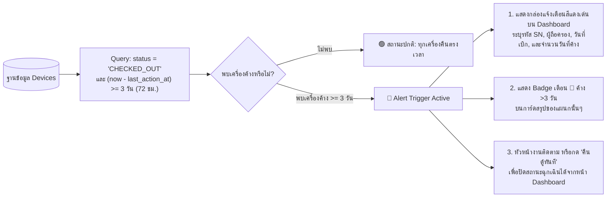
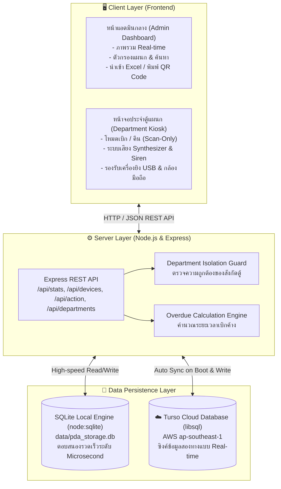

# ⚡ PDA Storage & Cabinet Management System
ระบบบริหารจัดการตู้จัดเก็บและแท่นชาร์จ PDA ประจำแผนก (Real-Time PDA Locker & Asset Tracking)

---

## 🔄 ผังขั้นตอนการทำงานของระบบ (System Workflow & Architecture Flows)

### 1. ผังการเบิก-คืน PDA ประจำหน้าตู้ (Kiosk Operation & Guard Flow)
```mermaid
flowchart TD
    Start([พนักงานมาที่หน้าตู้ประจำแผนก]) --> Mode{เลือกโหมดการทำงาน}

    %% Check-Out Branch
    Mode -->|1. เบิกออก (Check-Out)| ScanStaff[1. ยิงบาร์โค้ด / พิมพ์รหัสพนักงาน Staff ID]
    ScanStaff --> ScanDevOut[2. ยิงบาร์โค้ดเครื่อง PDA\nOriginal SN หรือ Custom Code]
    ScanDevOut --> CheckDeptOut{เครื่องสังกัดตู้แผนกนี้หรือไม่?}

    CheckDeptOut -->|ไม่ใช่ / ข้ามตู้| RejectOut[❌ ปฏิเสธรายการ REJECT\nส่งเสียงไซเรนเตือน + แสดงกล่องแดง\nห้ามเบิกข้ามตู้]
    RejectOut --> EndOutFail([ยกเลิกรายการ])

    CheckDeptOut -->|สังกัดตู้ถูกต้อง| CheckStatusOut{สถานะปัจจุบันในระบบ}
    CheckStatusOut -->|เดิมถูกเบิกอยู่แล้ว| WarnOut[⚠️ แจ้งเตือน: เครื่องมีผู้ถือครองอยู่แล้ว]
    WarnOut --> ConfirmOut[อัปเดตเป็นผู้ถือครองคนใหม่]
    CheckStatusOut -->|อยู่ในตู้ IN_CABINET| ConfirmOut

    ConfirmOut --> SaveOut[💾 บันทึกสถานะ: CHECKED_OUT 🔴\nผูก Staff ID + เวลาที่เบิก Timestamp Out\nบันทึก Transaction Log]
    SaveOut --> CloudSyncOut[☁️ ซิงค์ข้อมูล Real-Time ไปยัง Turso Cloud]
    CloudSyncOut --> SuccessOut[🔔 ส่งเสียงแจ้งเตือนสำเร็จ Chime Sound\nแสดงบัตรผู้ถือครองบนหน้าจอ]
    SuccessOut --> EndSuccessOut([นำ PDA ไปใช้งาน])

    %% Check-In Branch
    Mode -->|2. คืนเข้าตู้ (Check-In)| ScanDevIn[1. ยิงบาร์โค้ดเครื่อง PDA เสียบเข้าตู้]
    ScanDevIn --> CheckDeptIn{เครื่องสังกัดตู้แผนกนี้หรือไม่?}

    CheckDeptIn -->|ไม่ใช่ / ผิดตู้| RejectIn[❌ ปฏิเสธรายการ REJECT\nส่งเสียงไซเรนเตือน\nแจ้งเตือนตู้สังกัดที่ถูกต้อง]
    RejectIn --> EndInFail([ยกเลิกรายการ])

    CheckDeptIn -->|สังกัดตู้ถูกต้อง| SaveIn[💾 บันทึกสถานะ: IN_CABINET 🟢\nเคลียร์ผู้ถือครอง + เวลาที่คืน Timestamp In\nบันทึก Transaction Log]
    SaveIn --> CloudSyncIn[☁️ ซิงค์ข้อมูล Real-Time ไปยัง Turso Cloud]
    CloudSyncIn --> SuccessIn[🔔 ส่งเสียงแจ้งเตือนสำเร็จ Chime Sound\nไฟสถานะเปลี่ยนเป็นสีเขียวพร้อมใช้งาน]
    SuccessIn --> EndSuccessIn([เก็บ PDA เข้าตู้เรียบร้อย])
```

---

### 2. ผังระบบตรวจจับและติดตามอุปกรณ์ค้างเกิน 3 วัน (Overdue Alert Flow)


---

### 3. ผังสถาปัตยกรรมระบบและการซิงค์คลาวด์ (System Architecture Flow)


---

## 🌟 ฟังก์ชันหลักตาม Requirement

1. **Dual Serial Number & Custom QR Tag (ระบบ 2 รหัส)**
   - ผูกรหัส Original Serial Number (จากโรงงาน เช่น `SN001`) เข้ากับรหัสย่อเฉพาะของเรา (เช่น `ad001`)
   - **พนักงานสามารถยิงสแกนได้ทั้งสองรหัส**: ไม่ว่าจะยิง SN เดิมจากโรงงาน หรือยิง QR Code รหัสย่อใหม่ ระบบจะตรวจพบเป็นเครื่องเดียวกัน
   - มีระบบสร้างและสั่งพิมพ์สติ๊กเกอร์ QR Code (Asset Tag) ติดตัวเครื่อง ทั้งแบบเดี่ยวและแบบพิมพ์แผ่นรวม

2. **ระบบนำเข้าไฟล์ Serial Number (Excel / CSV Batch Upload)**
   - รองรับการอัปโหลดไฟล์ Excel (`.xlsx`, `.xls`) และ `.csv`
   - มีปุ่มดาวน์โหลดไฟล์ตัวอย่าง (Template) ให้ล่วงหน้า
   - มีระบบ Preview ตรวจสอบความถูกต้องและแจ้งเตือน SN ซ้ำก่อนกดยืนยันนำเข้า
   - หากเว้นช่อง Custom Code ว่างไว้ ระบบจะทำการรันเลขอัตโนมัติ (`ad...`) ต่อจากเครื่องล่าสุดให้เองทันที!

3. **หน้าจอแยกประจำแต่ละแผนก (Department Kiosk Pages)**
   - แผนกทั้งหมด 7 แผนก:
     - `IB` : Inbound (รับเข้าสินค้า)
     - `MS` : Manual Sort (คัดแยกด้วยมือ)
     - `CBS` : Cross Belt Sort (คัดแยกสายพาน Cross Belt)
     - `MCBS` : Mini Cross Belt Sort (คัดแยกสายพาน Mini Cross Belt)
     - `OBI` : Outbound Induction (อินดักชั่นขาออก)
     - `OBS` : Outbound Sort (คัดแยกขาออก)
     - `OBD` : Outbound Dispatch (จ่ายสินค้าออก)
   - **การเบิกออก (Check-Out)**: พนักงานสแกนรหัสพนักงาน (Staff ID) + ยิงรหัส PDA -> ระบบบันทึก Log เวลาออก (Timestamp Out) และเปลี่ยนสถานะเครื่องเป็น **สีแดง (นำไปใช้งาน)**
   - **การคืนเข้าตู้ (Check-In)**: พนักงานยิงรหัส PDA เสียบเข้าตู้ -> ระบบบันทึก Log เวลาเข้า (Timestamp In) และเปลี่ยนสถานะเครื่องเป็น **สีเขียว (ในตู้ชาร์จ)**

3. **ระบบป้องกันการยิงข้ามตู้ (Department Isolation Guard)**
   - หาก Admin กำหนดให้อุปกรณ์ผูกไว้กับตู้ **IB** แล้วมีผู้นำไปยิงที่หน้าตู้ **OBS**:
   - ระบบจะ **ปฏิเสธรายการทันที (REJECT)** พร้อมส่งเสียงเตือนไซเรน (Buzzer) และขึ้นข้อความสีแดงเตือนชัดเจนว่า *"อุปกรณ์สังกัดตู้แผนก IB เท่านั้น ไม่อนุญาตให้ทำรายการที่ตู้ OBS"*

4. **หน้าจอแอดมินกลาง (Central Admin Dashboard)**
   - ดูภาพรวมสถานะ PDA ของทุกตู้ทุกแผนกพร้อมกันแบบเรียลไทม์
   - ไฟสถานะ LED ชัดเจน:
     - 🟢 **สีเขียว (Green LED Glow)** = PDA ชาร์จอยู่ในตู้ พร้อมใช้งาน
     - 🔴 **สีแดง (Red LED Glow)** = PDA ถูกเบิกออกไปใช้งาน (แสดงรหัสพนักงานผู้ถือครอง + เวลาที่เบิก)
   - จัดการเพิ่ม/แก้ไข/ลบ PDA, สั่งพิมพ์สติ๊กเกอร์ QR Code ทั้งแบบเดี่ยวและแบบแผ่นรวม
   - ดูประวัติ Log การเบิก-คืน ย้อนหลัง ค้นหา และกด Export เป็นไฟล์ Excel / CSV ได้ทันที

---

## 🚀 วิธีการเปิดใช้งาน (How to Run)

### วิธีที่ 1: ดับเบิ้ลคลิกไฟล์รันอัตโนมัติ (ง่ายที่สุด)
- ดับเบิ้ลคลิกที่ไฟล์ **`start.bat`**
- ระบบจะเปิดเบราว์เซอร์และเริ่มการทำงานที่พอร์ต `3050` ทันที

### วิธีที่ 2: รันผ่าน Terminal / Command Prompt
```bash
npm start
```
เมื่อรันแล้ว สามารถเข้าใช้งานผ่านเบราว์เซอร์ได้ที่:
- **หน้าจอแอดมินกลาง**: [http://localhost:3050](http://localhost:3050)
- **หน้าจอประจำตู้แผนก**:
  - แผนก IB: [http://localhost:3050/dept/IB](http://localhost:3050/dept/IB)
  - แผนก MS: [http://localhost:3050/dept/MS](http://localhost:3050/dept/MS)
  - แผนก CBS: [http://localhost:3050/dept/CBS](http://localhost:3050/dept/CBS)
  - แผนก MCBS: [http://localhost:3050/dept/MCBS](http://localhost:3050/dept/MCBS)
  - แผนก OBI: [http://localhost:3050/dept/OBI](http://localhost:3050/dept/OBI)
  - แผนก OBS: [http://localhost:3050/dept/OBS](http://localhost:3050/dept/OBS)
  - แผนก OBD: [http://localhost:3050/dept/OBD](http://localhost:3050/dept/OBD)

---

## 🌐 การนำไปใช้งานบนอุปกรณ์อื่น & การโฮสต์ (Hosting & Networking)

### 1. ใช้งานผ่าน Wi-Fi / LAN วงเดียวกันในคลังสินค้า
คอมพิวเตอร์ แท็บเล็ต หรือมือถือในคลังสินค้าที่ต่อ Wi-Fi วงเดียวกัน สามารถเข้าใช้งานได้ทันทีโดยไม่ต้องต่ออินเทอร์เน็ตภายนอก:
```
http://<IP_เครื่องแม่>:3050
ตัวอย่างเช่น: http://192.168.1.150:3050/dept/IB
```
*(ดู IP เครื่องแม่ได้โดยเปิด CMD แล้วพิมพ์ `ipconfig`)*

### 2. นำขึ้นอินเทอร์เน็ตผ่าน Serveo (พร้อมระบบ Anti-Sleep Keep-Alive ไม่หลับ ไม่หลุด)
ต้องการให้อุปกรณ์ภายนอกเข้าใช้งานได้ หรือใช้งานผ่านมือถือ/แท็บเล็ต:
- ดับเบิ้ลคลิกไฟล์ **`start-serveo.bat`** (หรือรัน `node tunnel.js`)
- **มีระบบป้องกันการหลับ (Anti-Sleep Active)**:
  1. ส่ง **SSH Keep-Alive Packet ทุก 15 วินาที** ป้องกันเราเตอร์ตัดการเชื่อมต่อ
  2. ยิง **HTTP Heartbeat Ping ทุก 30 วินาที** ไปที่ URL `*.serveousercontent.com` เพื่อป้องกันไม่ให้เซิร์ฟเวอร์ Serveo ตัดการเชื่อมต่อเมื่อไม่มีคนใช้งาน
  3. มี **ระบบ Auto-Reconnect อัตโนมัติ** หากเน็ตหลุดจะต่อใหม่ให้เองทันที
  4. มีคำสั่ง **ป้องกัน Windows Sleep Mode** ระหว่างเปิดรัน เพื่อให้ตู้ PDA ทำงานได้ตลอด 24 ชั่วโมง
- นำลิงก์ `https://xxxx.serveousercontent.com` ที่ปรากฏบนหน้าจอไปเปิดบนแท็บเล็ตหรือมือถือใช้งานได้ทันทีทั่วโลก!

---

## 💾 ข้อมูลฐานข้อมูล (Database)
- ใช้ **SQLite** ผ่านโมดูลความเร็วสูงในตัวของ Node.js (`node:sqlite`)
- ไฟล์ฐานข้อมูลจะถูกเก็บไว้ที่โฟลเดอร์ `data/pda_storage.db`
- ไม่ต้องติดตั้งโปรแกรมฐานข้อมูลแยก (Zero-Config)
- พกพาสะดวก สามารถก็อปปี้โฟลเดอร์โปรเจกต์นี้ไปรันบนคอมพิวเตอร์เครื่องไหนก็ได้ ข้อมูลไม่สูญหาย

---

## 🔊 การรองรับเครื่องยิงบาร์โค้ด & กล้องมือถือ
- **เครื่องยิงบาร์โค้ดทั่วไป (Handheld Barcode Scanner)**: เสียบ USB หรือ Bluetooth แล้วยิงได้ทันที ตัวระบบจะดักจับ Enter และกดบันทึกให้อัตโนมัติ
- **กล้องสแกนผ่านมือถือ/แท็บเล็ต**: มีปุ่ม "📷 เปิดกล้องสแกน QR" รองรับการสแกนผ่านเลนส์กล้องของอุปกรณ์ได้โดยตรง
- **เสียงตอบรับ (Sound Feedback)**: 
  - เสียงกระดิ่งไพเราะ (Chime) เมื่อเบิกหรือคืนสำเร็จ
  - เสียงไซเรนเตือน (Buzzer) เมื่อยิงผิดตู้หรือเกิดข้อผิดพลาด
